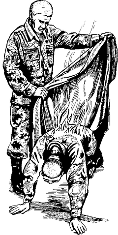
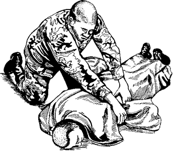
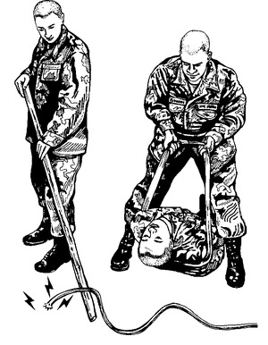

# Burns

> **Australian advice:** cool the burn under **cool running water for at least
> 20 minutes**, as soon as possible. It still helps up to **3 hours** after the
> burn. Chemical burns: remove contaminated clothing and rinse for up to 60
> minutes. Cover with a light, loose, non-stick dressing; **cling film** works
> well, **but not on the face**. Call **000** for deep burns, burns to the face,
> hands or genitals, chemical or electrical burns, or any breathing difficulty.

## If someone is on fire

**Stop, drop and roll.** Wrap them in something thick (a wool or cotton coat,
rug or blanket) to smother the flames, and pour water on them.

*Smother the flames and roll them on the ground.*

**Electrical burn:** don't touch the person while they may still be in contact
with power. Push them away from the source with something **non-metal and
dry** (a wooden broom handle, for example).

## Is it serious? Get emergency help if:

- The burn is **about the size of your palm or bigger**
- It's a deep (full-thickness) burn
- It was caused by **chemicals or electricity**
- The person **breathed in smoke**, or shows signs of **shock** (see
  [shock.md](shock.md))
- You aren't sure how bad it is

## Minor burn (small, skin not broken)

1. **Cool it** under cool running water, or soak it in cool water (**not ice
   water**), for **5 to 30 minutes**.
2. Cover it loosely with a dry, sterile bandage or clean cloth. Protect it from
   rubbing and pressure.
3. For pain, ibuprofen or acetaminophen (paracetamol) can help.
   **No aspirin for anyone under 19.**
4. Once cooled, an aloe lotion can soothe it. If the skin is broken, use an
   antibiotic ointment so the bandage doesn't stick.
5. Check that their tetanus vaccination is up to date.

## Major burn

1. Make sure they are no longer touching anything burning or smoking.
2. Check their breathing. Start CPR if needed (see [cpr.md](cpr.md)).
3. Cover the burn with a **dry** sterile bandage or clean cloth.
4. Burned fingers or toes: separate them with dry, non-stick dressings.
5. Raise the burned area **above heart level** if possible, and protect it from
   pressure.
6. **Prevent shock:** if there's no head, neck, back or leg injury, lay them
   flat, raise their feet about **12 inches (30 cm)**, and cover them with a
   blanket.
7. Keep watching their breathing until help arrives.

## Don't

- **Don't put butter, oil, ice, creams, sprays or home remedies** on a severe
  burn.
- **Don't put a severe burn in cold water.** It can cause shock.
- Don't break blisters or remove dead skin.
- Don't pull off clothing that is stuck to the burn.
- Don't breathe, blow or cough on the burn.
- Don't give food or drink to someone with a severe burn.
- If the airway may be burned, don't put a pillow under their head.

---

**Sources** (checked 2026-11-01)

- MedlinePlus (US National Library of Medicine), Burns:
  https://medlineplus.gov/ency/article/000030.htm
- healthdirect (Australian Government), Burns and scalds:
  https://www.healthdirect.gov.au/burns-and-scalds
- Drawings: see [images/CREDITS.md](images/CREDITS.md)
