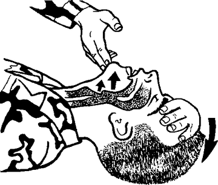
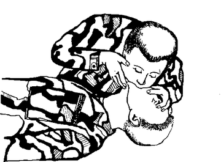
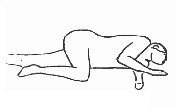
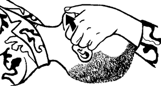

# CPR (Adult)

For an adult who is **unresponsive and not breathing normally**.

> **Do not** start chest compressions if the person is breathing normally,
> coughing or moving. It can stop a heart that is still beating.

## Steps

1. **Check if they respond.** Tap or gently shake them and shout "Are you OK?"
2. **Get help.** If there is no response, call your local emergency number (or
   have someone call). If you **know** there is an AED (defibrillator) nearby,
   send someone for it. Don't leave the person to search for one.
3. **Lay them on their back** on a firm, flat surface. If a spine injury is
   possible, use two people to move them.
4. **Hand position:** heel of one hand in the **center of the chest, between
   the nipples**, other hand on top, fingers interlaced. Lock your elbows and
   keep your shoulders directly over your hands.
5. **Push hard and fast:**
   - **Depth:** about **2 inches (5 cm)**
   - **Rate:** **100 to 120 per minute**
   - Let the chest come all the way back up after each push.
6. After **30 compressions**, give **2 rescue breaths**:
   - Tilt the head back (hand on forehead) and lift the chin with two fingers.
   - Pinch the nose, seal your mouth over theirs, and breathe for about
     **1 second** each, enough to make the chest rise.
   - Keep the pause for breaths **under 10 seconds**.
   
   

   *Head tilt and chin lift, then a rescue breath.*
7. **Repeat 30 compressions : 2 breaths.** With two or more rescuers, swap the
   person doing compressions every **2 minutes** (about 5 cycles). It's tiring.
8. **Use the AED as soon as it arrives.** Turn it on and do exactly what it
   says.

## When to stop

Keep going until the person starts breathing and moving again, or until
trained help takes over.

If they start breathing, roll them onto their side (recovery position) and
keep checking their breathing until help arrives.

*Recovery position.*

## Special cases

- **Suspected opioid overdose:** if naloxone (Narcan) is available, give it,
  but don't stop CPR to do so.
- **Suspected spine injury:** open the airway by pulling the jaw forward
  instead of tilting the head.

  
- **Not a health professional?** Don't spend time checking for a pulse.

## In Australia: DRSABCD

The same 30 compressions : 2 breaths at 100–120 per minute, remembered as
**DRSABCD**:

- **D**anger: make sure it's safe for you.
- **R**esponse: loudly ask their name, squeeze their shoulders.
- **S**end for help: call **000** (112 from a mobile). Don't leave them.
- **A**irway: check the mouth; tilt the head back and lift the chin.
- **B**reathing: look, listen and feel for 10 seconds.
- **C**PR: press down about **one third of the chest depth**; 30:2, about
  5 cycles every 2 minutes. **Can't give breaths? Do compressions only
  without stopping.** It may still save a life.
- **D**efibrillation: attach an AED as soon as one arrives and follow its
  voice prompts. Don't stop compressions to go and get one. Pads: upper right
  chest below the collarbone, and left side under the armpit.

## Be ready

CPR is a physical skill. Take a hands-on course (Red Cross, American Heart
Association, or your local fire department) while you can.

---

**Sources** (checked 2026-11-01)

- MedlinePlus (US National Library of Medicine), CPR – adults and children
  after onset of puberty: https://medlineplus.gov/ency/article/000013.htm
- healthdirect (Australian Government), How to perform CPR:
  https://www.healthdirect.gov.au/how-to-perform-cpr
- Drawings: see [images/CREDITS.md](images/CREDITS.md)
