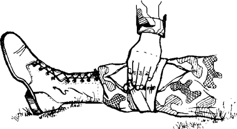
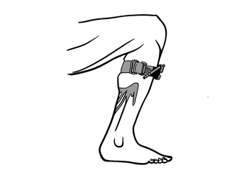
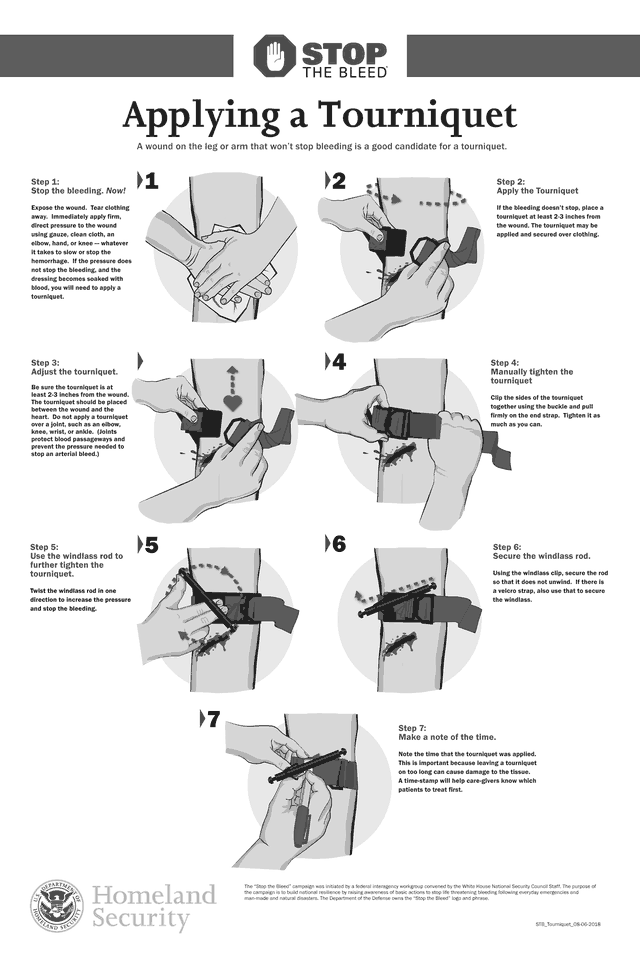

# Severe Bleeding

> **Act fast.** A person who is bleeding heavily can die from blood loss
> **within five minutes**. The people nearest are the ones who can save them.

If phones work, call your local emergency number, or send someone for help,
**while** you start these steps.

## Step 1: Direct pressure, now

1. **Expose the wound.** Tear or cut clothing away so you can see where the
   blood is coming from.
2. **Press hard, directly on the wound**, with gauze or clean cloth. If you
   have nothing, use your hand, elbow or knee: whatever it takes to slow or
   stop the bleeding.
3. **Keep pressing.**

*Firm, direct pressure on the wound.*

If pressure does not stop the bleeding and the dressing becomes soaked with
blood, **and the wound is on an arm or leg**, apply a tourniquet.

## Step 2: Tourniquet (arm or leg only)

1. **Place the tourniquet at least 2–3 inches (5–8 cm) from the wound,
   between the wound and the heart.** It can go over clothing.
2. **Never place it over a joint** (elbow, knee, wrist, ankle). Joints protect
   the blood vessels and stop the tourniquet from pressing hard enough.
3. **Pull the strap tight** through the buckle, as tight as you can.
4. **Twist the windlass rod** in one direction until the bleeding stops.
5. **Lock the rod** in its clip so it can't unwind, and secure it with the
   Velcro strap if there is one.
6. **Write down the time** the tourniquet was applied (on the tourniquet
   itself if you can). Leaving it on too long damages tissue, and the time
   helps medical staff decide who to treat first.

*Above the wound, between the wound and the heart, never over a joint.*

*All seven steps. Full-size poster:
[tourniquet-poster-dhs.pdf](tourniquet-poster-dhs.pdf) (US Department of
Homeland Security, in this folder).*

## Be ready before you need this

- Keep a commercial tourniquet in your first-aid kit and car, and practice
  with it.
- Take a free Stop the Bleed course while training is available:
  https://www.stopthebleed.org/

---

**Sources** (checked 2026-11-01)

- DHS / Stop the Bleed, "Applying a Tourniquet" poster (STB_Tourniquet_08-06-2018):
  https://www.dhs.gov/publication/stop-bleed-tourniquet
- DHS, Stop the Bleed: https://www.dhs.gov/stopthebleed
- Drawings: see [images/CREDITS.md](images/CREDITS.md)
