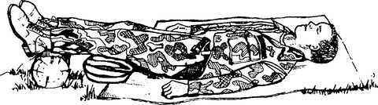
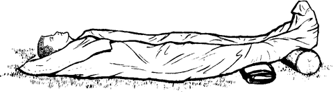
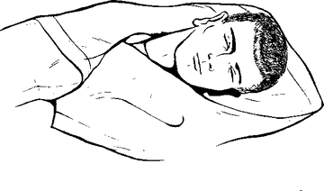

# Shock

Shock means the body isn't getting enough blood flow. It can follow heavy
bleeding, severe burns, serious injury, infection or allergic reactions.
**It is life-threatening.** Don't wait for it to get worse before getting help.

## Signs

- Pale, cool, clammy skin; heavy sweating
- Fast but weak pulse
- Fast, shallow breathing
- Dizziness, feeling faint
- Anxiety, restlessness, confusion
- Blue lips or fingernails
- Chest discomfort
- Little or no urine
- Passing out

## What to do

1. **Call your local emergency number right away.**
2. Check airway and breathing. Start CPR if needed (see [cpr.md](cpr.md)).
3. **Recheck breathing at least every 5 minutes**, even if they seem fine.
4. If they are conscious and have **no head, neck, spine or leg injury**: lay
   them on their back and **raise their legs about 12 inches (30 cm)**, head
   flat. If raising the legs hurts or could cause harm, leave them flat.

   
5. Treat other injuries (for bleeding, see
   [severe-bleeding.md](severe-bleeding.md)).
6. **Keep them warm** and comfortable. Loosen tight clothing.

   
7. If they vomit or drool, turn their head to the side so they don't choke.
   If a spine injury is possible, roll the **whole body** together, keeping
   head, neck and back in line.

   

## Don't

- **Don't give them anything to eat or drink.**
- Don't move someone with a known or suspected spine injury.
- Don't wait for mild signs to get worse before calling for help.

---

**Sources** (checked 2026-11-01)

- MedlinePlus (US National Library of Medicine), Shock:
  https://medlineplus.gov/ency/article/000039.htm
- Drawings: see [images/CREDITS.md](images/CREDITS.md)
