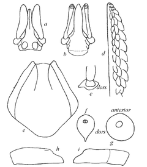

# Bites and Stings (Australia)

For anaphylaxis (trouble breathing, swollen tongue or throat, collapse): **call
000**, use an adrenaline autoinjector if they have one, lay them down and raise
their legs. **Poisons Information: 13 11 26.**

## Snake bite

**Call 000 for any snake bite.** Every snake bite needs a doctor, even if the
person seems fine.

**Pressure immobilisation bandage:**

1. **Keep the person still and calm**, away from the snake. Stay with them.
2. Put a **broad roller bandage (10–15 cm wide) firmly over the bite.**
3. With a second bandage, **wrap the whole limb**, starting just above the
   fingers or toes and working up toward the body.
4. **Firm:** you shouldn't be able to slide a finger easily under the bandage.
5. **Splint** the limb so it can't move.
6. **Write down the time** of the bite and when the bandage went on. Mark the
   bite site on the bandage, or take a photo.
7. If they stop responding or breathing normally, start CPR (see
   [../01-emergency/cpr.md](../01-emergency/cpr.md)).

**Don't:**

- **Don't wash the bite.** Venom left on the skin helps identify the snake.
- **Don't use a tourniquet.**
- Don't cut the wound or try to suck out the venom.
- Don't try to catch or kill the snake.

## Spider bite

**Funnel-web, mouse spider, or any big black spider: call 000.** Use the
**same pressure immobilisation bandage** as for snake bite (above): keep them
lying still, bandage firmly but not cutting off circulation, splint, mark the
site, note the times.

**Redback:** wash with soap and water, apply a **cold pack for 15 minutes**,
and see a doctor if symptoms are bad. Severe pain: go to hospital. **No pressure
bandage**; that is only for funnel-web and mouse spiders.

**Other spiders:** wash, apply antiseptic, use an ice pack wrapped in cloth,
paracetamol or ibuprofen for pain. See a doctor if the pain is bad, it doesn't
settle in a few hours, or it gets worse after 1–2 days.

## Tick bite (paralysis tick)

The **paralysis tick** is the most common tick in eastern Australia.

*Adult female paralysis tick (enlarged).*

1. **Kill it first:** freeze it with an **ether-containing spray** from a
   pharmacy. It should drop off within about 5 minutes. (If it's embedded,
   permethrin cream can be used.)
2. **Don't pull, squeeze or twist it.** That makes it inject more saliva.
3. Don't use home remedies (methylated spirits, kerosene, Vaseline, nail
   polish, oil, alcohol, matches). They can make it burrow deeper.
4. Wash the area with soap and water.
5. If it won't come off or can't be frozen, leave it and **get medical help**.

**Tick allergy:** if you know you're allergic, get medical help as soon as you
find an attached tick. Don't remove it yourself. Carry your adrenaline
autoinjector.

See a doctor if, days later, there's headache, blurred vision, weakness or poor
balance (tick paralysis is rare).

## Jellyfish (bluebottle) sting: Noosa beaches

Noosa is in **non-tropical** waters (south of Bundaberg).

1. **Rinse with sea water, not fresh water.**
2. Pick off tentacles (by hand is OK) or wash them off with sea water.
3. Put the area in **hot water at about 45 °C for 20 minutes**. Check it won't
   burn. Or use a hot shower. Hot water works better than ice.
4. **Don't use vinegar on a bluebottle sting.** It can increase the pain.

See a doctor if severe pain doesn't improve. If the person collapses or stops
breathing, call 000 and start CPR.

**Travelling north of Bundaberg (tropical waters)?** Box jellyfish and
Irukandji stings are life-threatening: **call 000**, remove tentacles, **pour
vinegar** on the site, apply ice, and go to hospital. If you don't know what
stung you up there, treat it as a box jellyfish.

---

**Sources** (checked 2026-11-01)

- healthdirect (Australian Government), Snake bites:
  https://www.healthdirect.gov.au/snake-bites
- healthdirect, Spider bites: https://www.healthdirect.gov.au/spider-bites
- healthdirect, Tick bites: https://www.healthdirect.gov.au/tick-bites
- healthdirect, Jellyfish stings: https://www.healthdirect.gov.au/jellyfish-stings
- Drawing: see [images/CREDITS.md](images/CREDITS.md)
