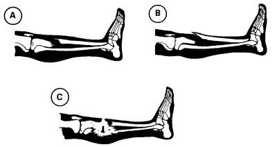
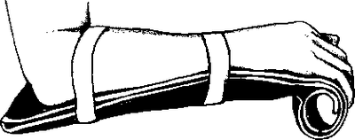
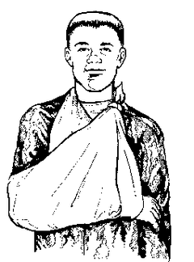
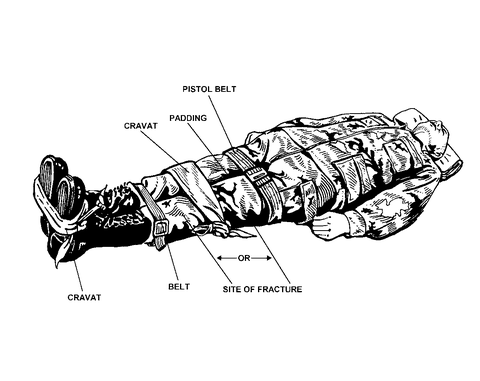

# Broken Bones

## Signs

- A limb or joint that looks **out of place or misshapen**
- Swelling, bruising or bleeding
- Pain, often severe
- Numbness or tingling
- **Bone poking through the skin**
- Can't move the limb or put weight on it

A young child who won't use a limb or put weight on it should be treated as if
it's broken.

*Closed fractures (A, B) and an open fracture with bone through the skin (C).*

## Get emergency help if

- The person isn't responding or is losing consciousness
- A break in the **head, neck or back** is possible
- A break in the **hip, pelvis or upper leg** is possible
- **Bone is sticking out** through the skin
- Bleeding is severe
- The area below the injury is **pale, cold, clammy or blue**
- You can't keep the injury still by yourself

Other breaks still need a doctor soon.

## What to do

1. **Check breathing first.** Start CPR or control bleeding if needed (see
   [../01-emergency/cpr.md](../01-emergency/cpr.md),
   [../01-emergency/severe-bleeding.md](../01-emergency/severe-bleeding.md)).
2. **Keep the person still and calm.** Look for other injuries.
3. **Bone through the skin:** don't breathe on it or touch it. Cover it with a
   clean (sterile if possible) dressing. Don't try to push the bone back.
4. **Splint it** so it can't move. Immobilize the joints **above and below**
   the break. You can improvise a splint with rolled-up newspaper, a magazine
   or strips of wood, tied on with cloth. Use a sling for an arm.

   
   
   

   *A board splint for the forearm, an arm sling, and, with nothing else to
   hand, the good leg used as a splint for the broken one.*
5. **Ice and raise** the injured limb to ease pain and swelling.
6. **Check circulation** below the break: press the skin. It should go white
   and turn pink again within about **2 seconds**. Pale or blue skin, numbness,
   tingling or no pulse means poor blood flow. If blood flow is poor and
   trained help isn't coming soon, gently move the limb back into a normal
   resting position.
7. **Watch for shock** (see [../01-emergency/shock.md](../01-emergency/shock.md)):
   lay them flat, raise their feet about 12 inches (30 cm) and cover them, **but
   not if a head, neck or back injury is possible.**

## Don't

- **Don't move someone who may have a spine injury.**
- Don't move someone with a hip, pelvis or upper leg injury unless you
  absolutely must. If you must, drag them by their clothing.
- Don't straighten the bone or change its position, unless blood flow is poor
  and no trained help is nearby.
- Don't test the limb by moving it.
- Don't use a tourniquet unless the bleeding is life-threatening.

---

**Sources** (checked 2026-11-01)

- MedlinePlus (US National Library of Medicine), Broken bone:
  https://medlineplus.gov/ency/article/000001.htm
- Drawings: see [images/CREDITS.md](images/CREDITS.md)
