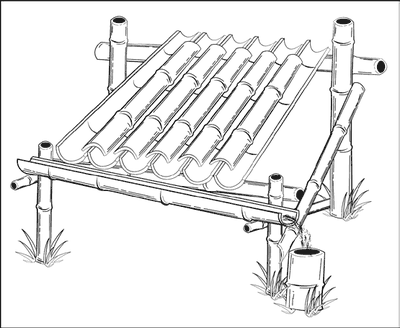
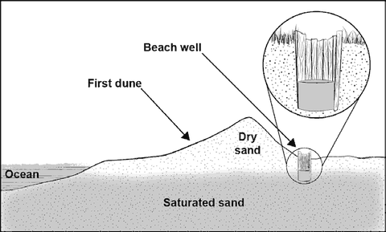
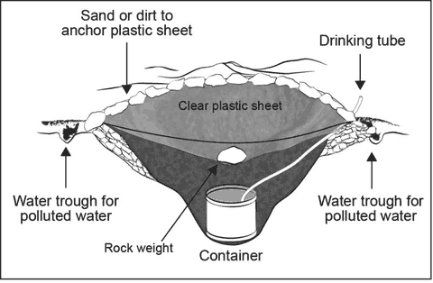
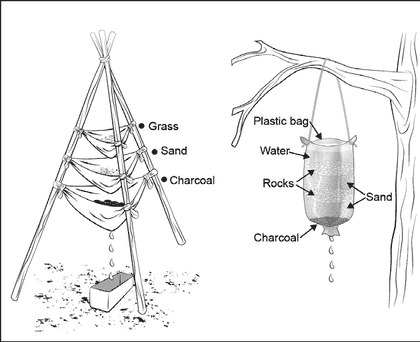

# Collecting Water When the Taps Stop

> **Treat all collected water before drinking it**: boil it, or use bleach.
> See [making-water-safe.md](making-water-safe.md). Filtering makes water
> clearer, but **doesn't make it safe**.

Start with the water you already have at home (see
[finding-water.md](finding-water.md)). These methods are for when that runs out.

## Rain

Put out anything that holds water (buckets, pots, tarps folded into a channel)
to catch rain as it falls. Rain that runs off leaves and plants on the way to
the container picks up dirt and germs.

*A simple rain catcher: overlapping channels on a frame, tilted so the water
runs into a container.*

## Beach well (near the coast)

Never drink sea water. Behind the **first line of sand dunes**, dig down until
you reach the water table. Water that seeps in there is usually fresh. Line the
sides with wood so the sand doesn't cave in.

## Solar still

A still pulls water out of damp soil or plants using the sun. It can also make
drinkable water from **salty or polluted water** (pour it into a small trench
next to the hole, not inside it). It's **slow**: you need **three or more** to
supply one person, and digging costs you water in sweat.

1. In a sunny spot with damp soil, dig a bowl-shaped hole about **1 m across and
   60 cm deep**, with a smaller hole in the middle for a container.
2. Stand the container in the middle. Run a drinking tube from it to outside the
   hole, if you have one.
3. Cover the hole with **clear plastic**, holding the edges down with soil.
4. Put a **rock in the centre** so the plastic forms a cone, **about 40 cm**
   below ground, right over the container. The plastic mustn't touch the sides.
5. Water condenses under the plastic and drips into the container. Plug the tube
   when you're not drinking.

## Filtering muddy water

1. Let muddy water **stand for a few hours** so the dirt settles. Pour off the
   clear water.
2. Or pour it through layers of **sand, gravel and charcoal** (from a fire) in a
   bag, bottle or cloth layers.
3. **Then boil or disinfect it.** Filtering doesn't kill germs.

---

**Sources** (checked 2026-11-01)

- US Army, *ATP 3-50.21 Survival* (2018), chapter 3 "Water" (approved for
  public release): https://armypubs.army.mil/ProductMaps/PubForm/Details.aspx?PUB_ID=1005316
- CDC, How to Find Clean Water in an Emergency (rainwater must be treated):
  https://www.cdc.gov/water-emergency/about/how-to-find-clean-water-in-an-emergency.html
- Drawings: see [images/CREDITS.md](images/CREDITS.md)
