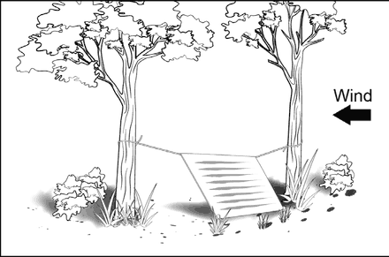
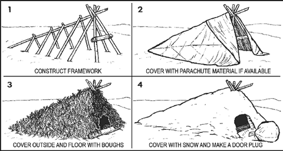
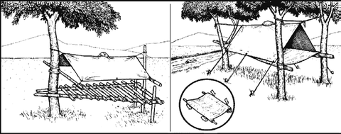

# Improvised Shelter

If your home isn't safe and you can't reach an evacuation centre, use what's
already there first: **a vehicle, a wall or another building**, a rock overhang,
or a fallen tree with thick branches. Building from scratch takes much more time
and energy.

## Choosing a spot

- **Flat and big enough** to lie down, with room for your gear
- **Away from flood areas, high-water marks and flash-flood channels**, and from
  slopes that could slide
- **No dead trees or branches** that could fall on you
- Out of the wind and sun
- Brush away rocks and twigs, and **check for snakes, ticks and ants**
- Easy to be seen by rescuers

## Tarp lean-to (fastest)

You need a tarp (or poncho or plastic sheet), about **2–3 m of rope**, three
short stakes, and two trees or poles about **2–3 m apart**.

1. Check the wind. **The back of the lean-to faces into the wind.**
2. Tie a rope to each corner along one long edge of the tarp.
3. Tie the ropes about **waist-high** to the two trees, tight (round turn and two
   half hitches, see [knots.md](knots.md)).
4. Stretch the tarp out and **stake the other edge to the ground**.
5. Rain expected? Add a centre support: a line from the middle of the tarp up to
   an overhanging branch, so water doesn't pool.
6. Block the open sides with brush or gear, and put **leaves or grass on the
   floor**: lying on bare ground draws heat out of your body.

*Tip: a short stick tied to each rope near the tarp stops rain running down the
rope into the shelter.*

## A-frame

A ridge pole resting on two crossed poles, covered with a tarp or with layers of
leaves and bark laid **from the bottom up**, like roof tiles. Keep the sides
steep (**40–60°**) so rain runs off. Stretch the cover tight: water pools in
wrinkles and leaks through.

## Raised platform (wet or swampy ground)

Lash two strong poles between four trees, lay cross-pieces every **15–30 cm** to
make a bed, and build an A-frame roof above it. Keeps you off wet ground. Cover
it with a net or fabric against insects.

---

**Sources** (checked 2026-11-01)

- US Army, *ATP 3-50.21 Survival* (2018), chapter 6 "Shelter and Clothing"
  (approved for public release): https://armypubs.army.mil/ProductMaps/PubForm/Details.aspx?PUB_ID=1005316
- Drawings: see [images/CREDITS.md](images/CREDITS.md)
