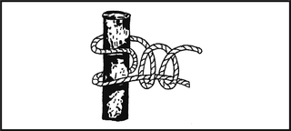
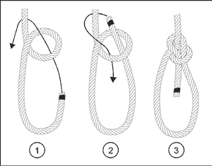
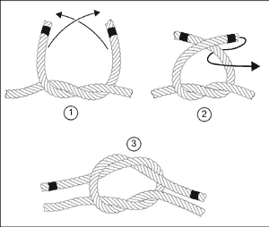
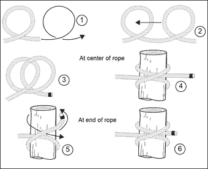
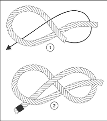

# Five Useful Knots

Practise these now, with a piece of rope, until you can tie them without looking.

## Round turn and two half hitches: tie a rope to a tree or pole

The main knot for anchoring a rope to a tree or pole. It holds under a heavy
load and still unties easily. Use it to hang a tarp.

## Bowline: a loop that won't slip

Makes a fixed loop at the end of a rope that's easy to untie.

1. Make a small loop in the standing part of the rope.
2. Bring the end **up through the loop from underneath**,
3. **around behind** the standing part,
4. and **back down through the loop**. Pull tight.

## Square knot (reef knot): join two ropes

For joining two ropes of the **same thickness**.

1. Cross the two ends and tuck one under the other.
2. Cross them again **the opposite way** and tuck again.
3. Each end should lie **alongside its own rope**. If not, it's a "granny knot",
   which slips. Retie it.

## Clove hitch: fasten a rope to a post

Quick to tie around a pole, pipe or post, and can be tied anywhere along a rope.
Two turns around the post, with the end tucked **under itself** on the second
turn.

## Figure-eight: stop a rope slipping through

A bulky knot at the end of a rope that stops it pulling through a hole or loop.
Make a loop, pass the end around the standing part, then down through the loop.

---

**Sources** (checked 2026-11-01)

- US Army, *ATP 3-50.21 Survival* (2018), appendix A "Survival Knots and Rope"
  (approved for public release): https://armypubs.army.mil/ProductMaps/PubForm/Details.aspx?PUB_ID=1005316
- Drawings: see [images/CREDITS.md](images/CREDITS.md)
