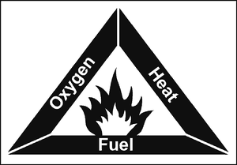
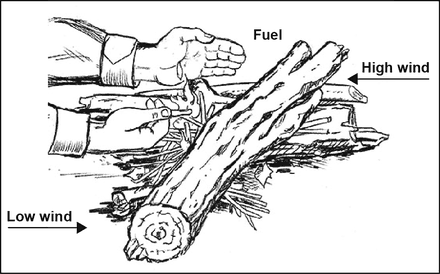
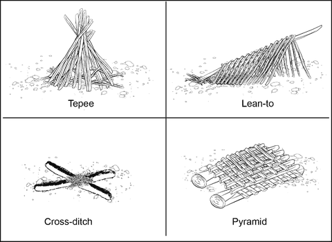
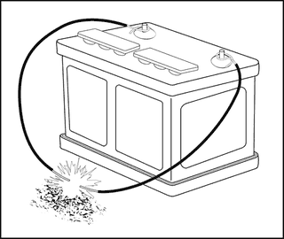
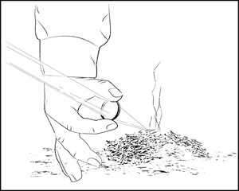

# Lighting a Fire

> **Check the day's Fire Danger Rating and any fire bans first** (see
> [../12-noosa-tewantin/warnings.md](../12-noosa-tewantin/warnings.md)).
> If you light a fire, you're responsible for keeping it under control.

## How fire works

A fire needs **heat, fuel and oxygen**. Take any one away and it goes out. If a
fire is struggling, rearrange the wood to change the mix of air and fuel.

## Choose and clear the spot

- **Flat, dry and out of the wind**, near your shelter and a supply of wood.
- **Clear at least 1 metre** of leaves and grass down to bare soil, so the fire
  can't creep along the ground.
- **Don't use porous rocks** around the fire. Water inside them can make them
  explode.

## Gather three sizes of fuel first

1. **Tinder** (catches a spark): dry grass, fine wood shavings, paper, cotton
   wool, lint. At least a cupped handful.
2. **Kindling** (catches from the tinder): dry twigs from **pencil-lead to thumb
   thickness**. A bundle as thick as a drink can of each size.
3. **Fuel** (keeps it going): dead, dry wood **at least as thick as your
   forearm**. Standing dead wood is drier than wood lying on the ground. Rotten
   wood smoulders and smokes.

Skip a stage and the fire usually dies.

## Build it

Lay the tinder on something dry (a flat piece of wood or bark) against a stick
used as a **brace**. Light the tinder at the bottom, away from the brace, then
lay handfuls of kindling **across the brace**, leaving gaps for air. Add bigger
wood as it catches.

## Fire lays

- **Tepee:** sticks leaned together in a cone over the tinder. Burns well even
  with damp wood.
- **Lean-to:** a green stick pushed into the ground at 30°, pointing into the
  wind, with tinder underneath and kindling leaning on it.
- **Cross-ditch:** dig an X about 30 cm across and 8 cm deep. Air flows in under
  the tinder.
- **Pyramid:** layers of logs, each smaller and crossways to the one below, with
  a small fire on top. It burns downwards and lasts all night with no tending.

## No matches?

**Car battery:** connect a wire to each terminal and touch their ends to a third,
bare wire (or stretch fine steel wool between the terminals) to make sparks or a
glowing coal for the tinder. **Keep flames away from the battery**: some
batteries give off explosive hydrogen gas.

**Magnifying glass or lens (sunny days only):** focus the sun on the tinder and
hold it there until it smoulders, then blow gently.

## Don't

- **Never pour petrol or other flammable liquid on a fire**, even one that looks
  out. It can explode.
- Don't burn tyres. The smoke is harmful to breathe.
- Don't cook food directly over a fire started with petrol or diesel.

---

**Sources** (checked 2026-11-01)

- US Army, *ATP 3-50.21 Survival* (2018), chapter 5 "Fire" (approved for public
  release): https://armypubs.army.mil/ProductMaps/PubForm/Details.aspx?PUB_ID=1005316
- Drawings: see [images/CREDITS.md](images/CREDITS.md)
