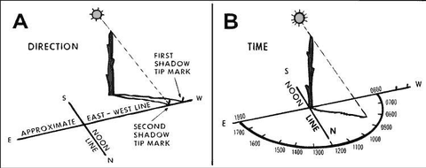
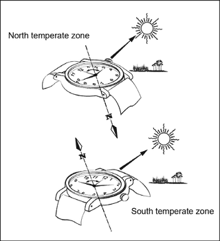
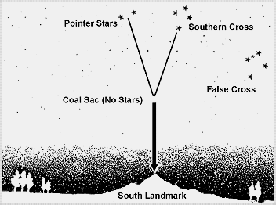
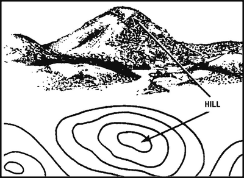

# Finding Direction Without GPS

> **In Australia (the Southern Hemisphere), the sun is due north at midday and
> shadows point south.** Most survival books are written for the Northern
> Hemisphere, where it's the other way round.

The sun rises roughly in the east and sets roughly in the west (rarely exactly
due east or west).

## Shadow-tip method (sun, any time of day)

1. Push a stick into the ground where it casts a clear shadow. **Mark the tip of
   the shadow** with a stone or twig. This first mark is always **west**.
2. Wait **10 to 15 minutes**, until the shadow tip has moved a few centimetres.
   Mark the new tip. This second mark is **east**.
3. Draw a straight line through the two marks: that's **east–west**.
4. Stand with the first mark (west) on your left: **north is in front of you**,
   east to your right, south behind you.

*The stick can lean, and any fixed object (like the end of a branch) works too.
Only the shadow tip matters.*

## Watch method (analog watch)

**Southern Hemisphere:** hold the watch flat and point the **12** at the sun.
Halfway between the 12 and the hour hand is **north**. On daylight saving time,
use halfway between the hour hand and the 1 instead (Queensland doesn't use
daylight saving; New South Wales and Victoria do in summer).

*Use the bottom drawing ("South temperate zone") in Australia.*

This can be inaccurate, especially closer to the equator. Check it with the
shadow-tip method when you can.

**Digital watch?** Draw a clock face showing the current time on paper or on the
ground and use that.

## Southern Cross (at night)

There's no bright "south star", so use the **Southern Cross** (Crux):

1. Find the **four bright stars** of the Cross. Nearby there's a dimmer
   **False Cross**. The real one has two bright **Pointer Stars** beside it.
2. Imagine a line along the **long axis** of the Cross, extended **4½ to 5
   times** its length.
3. Look straight down from that point to the horizon: that's **south**.
   Pick a landmark there to walk towards.

*If you're staying put, mark south at night with sticks in the ground so you
have it in daylight.*

## The moon

If the moon rises **before sunset**, its lit side faces **west**. If it rises
**after midnight**, its lit side faces **east**. That gives a rough east–west
line at night.

## Reading the land on a map

Contour lines join points of the same height. Closed rings, one inside the
other, are a hill; the smallest ring is the top.

---

**Sources** (checked 2026-11-01)

- US Army, *ATP 3-50.21 Survival* (2018), chapter 7 "Movement and Navigation"
  (approved for public release; distribution unlimited):
  https://armypubs.army.mil/ProductMaps/PubForm/Details.aspx?PUB_ID=1005316
- Drawings: see [images/CREDITS.md](images/CREDITS.md)
