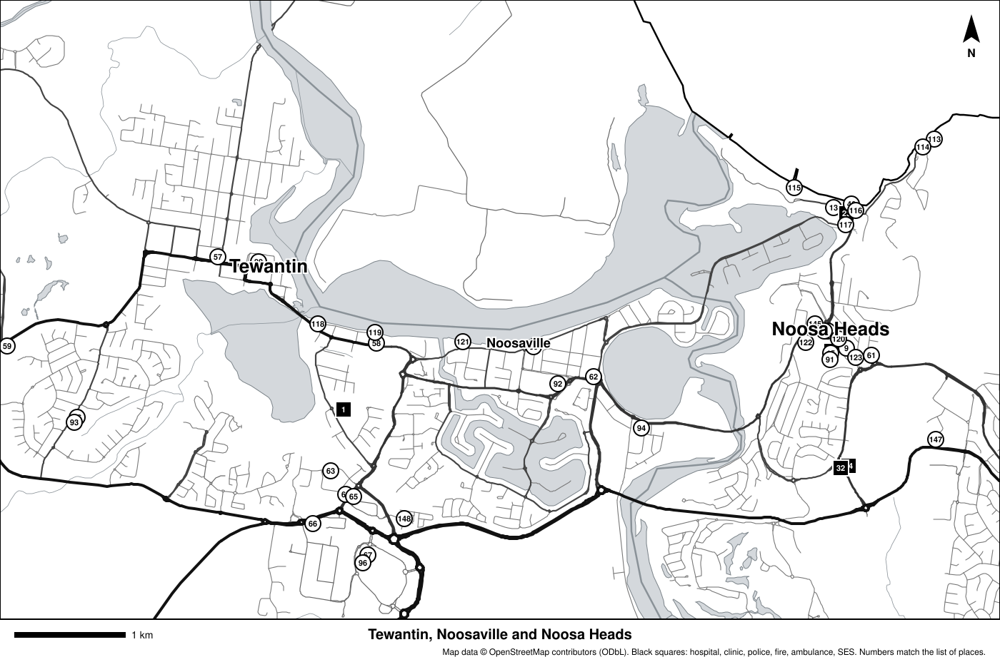
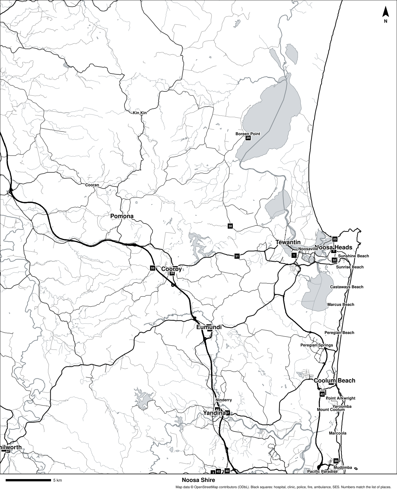

# Maps of Noosa

Two printable black-and-white maps, made from OpenStreetMap. Open the picture on
its own to zoom in, or print it.

- **Black squares** are emergency services and health: hospital, clinic, police,
  fire station, ambulance station, SES.
- **White circles** are other useful places: pharmacy, doctor, fuel,
  supermarket, drinking water, community centre, lifeguard.
- **Numbers** match the list in [key-places-noosa.md](key-places-noosa.md),
  which also gives each place's address, phone number (where known) and GPS
  coordinates.

## Tewantin, Noosaville and Noosa Heads

*Main roads are named. Scale bar: 1 km.*

## All of Noosa Shire

*Main roads, the Noosa River and lakes, towns, and emergency services.*

## Flood maps

Noosa Council's official flood maps for Tewantin, Noosaville and Noosa Heads are
saved by `./tools/download-local.sh` into `12-noosa-tewantin/downloads/` (see
[../12-noosa-tewantin/local-hazards.md](../12-noosa-tewantin/local-hazards.md)).

## On your phone

For a zoomable map with search and directions that works with no signal, see
[offline-map-apps.md](offline-map-apps.md).

> OpenStreetMap is made by volunteers. It may be missing places or be out of
> date. In an emergency, call **000**.

---

**Sources** (checked 2026-11-01)

- Map data © OpenStreetMap contributors, Open Database License:
  https://www.openstreetmap.org/copyright. Maps drawn with `tools/make-map.py`.
